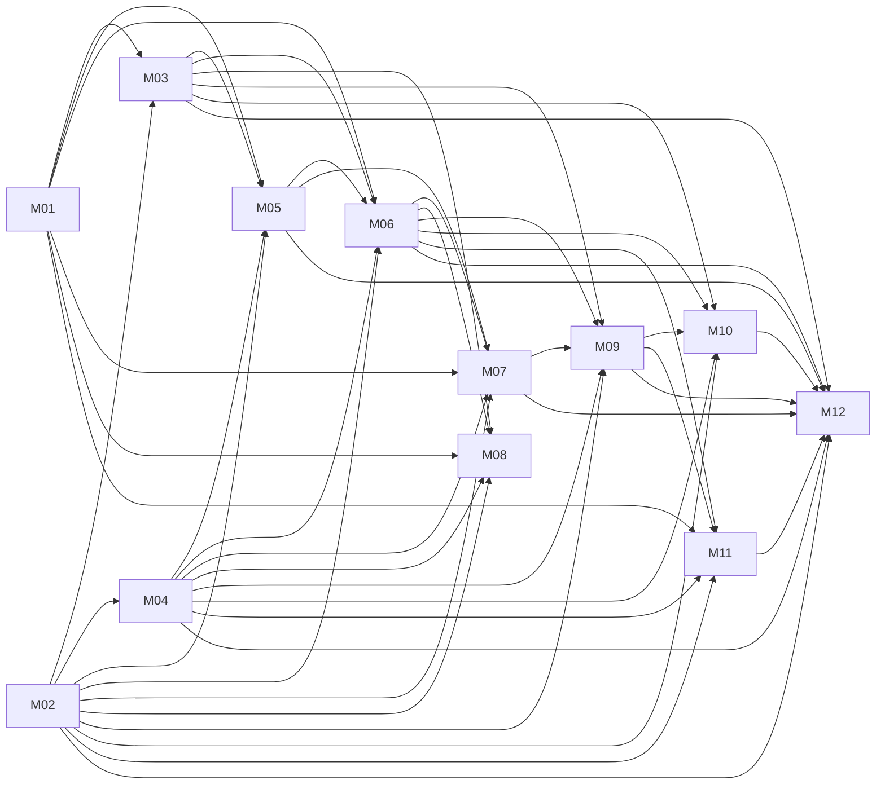

# 课程目录与依赖

由 curriculum/modules.json 与 lessons.json 生成。ID 永不复用；前置仅建议，不锁定访问。

## M01 — 线性代数与几何直觉（21 课）

| ID | 名称 | 直接前置 | 路由 slug |
|---|---|---|---|
| M01-001 | 标量与向量表示 | — | math/linear-algebra/scalars-vectors |
| M01-002 | 向量加法与数乘 | M01-001 | math/linear-algebra/vector-addition |
| M01-003 | 张量、阶数与形状 | M01-001 | math/linear-algebra/tensor-shapes |
| M01-004 | 向量空间 | M01-002 | math/linear-algebra/vector-spaces |
| M01-005 | 线性组合与张成 | M01-004 | math/linear-algebra/span |
| M01-006 | 线性相关与基 | M01-005 | math/linear-algebra/basis |
| M01-007 | 向量内积与夹角 | M01-002 | math/linear-algebra/dot-product |
| M01-008 | 范数与距离 | M01-007 | math/linear-algebra/norm-distance |
| M01-009 | 投影 | M01-007 | math/linear-algebra/projection |
| M01-010 | 正交分解 | M01-009 | math/linear-algebra/orthogonal-decomposition |
| M01-011 | 矩阵表示与矩阵乘法 | M01-002 | math/linear-algebra/matrix-multiplication |
| M01-012 | 矩阵作为线性变换 | M01-011 | math/linear-algebra/linear-transforms |
| M01-013 | 矩阵的秩 | M01-006、M01-012 | math/linear-algebra/rank |
| M01-014 | 零空间与解空间 | M01-013 | math/linear-algebra/null-space |
| M01-015 | 线性方程组与逆矩阵 | M01-014 | math/linear-algebra/inverse-systems |
| M01-016 | 伪逆 | M01-015、M01-010 | math/linear-algebra/pseudoinverse |
| M01-017 | 特征值与特征向量 | M01-012、M01-006、M01-007 | math/linear-algebra/eigenvectors |
| M01-018 | 奇异值分解 SVD | M01-017、M01-010、M01-013 | math/linear-algebra/svd |
| M01-019 | 低秩近似 | M01-018 | math/linear-algebra/low-rank |
| M01-020 | 最小二乘的几何解释 | M01-016、M01-010 | math/linear-algebra/least-squares |
| M01-021 | 张量运算与 Broadcasting | M01-003、M01-011 | math/linear-algebra/broadcasting |

## M02 — 概率论与统计推断（27 课）

| ID | 名称 | 直接前置 | 路由 slug |
|---|---|---|---|
| M02-001 | 概率空间与事件 | — | math/probability/events |
| M02-002 | 条件概率 | M02-001 | math/probability/conditional-probability |
| M02-003 | 全概率公式与 Bayes 定理 | M02-002 | math/probability/bayes-rule |
| M02-004 | 随机变量与分布函数 | M02-001 | math/probability/random-variables |
| M02-005 | 离散概率质量与连续概率密度 | M02-004 | math/probability/pmf-pdf |
| M02-006 | Bernoulli 与 Binomial 分布 | M02-005 | math/probability/bernoulli-binomial |
| M02-007 | Uniform 分布与均匀采样 | M02-005 | math/probability/uniform |
| M02-008 | Normal 分布 | M02-005 | math/probability/normal |
| M02-009 | 期望 | M02-005 | math/probability/expectation |
| M02-010 | 方差与标准差 | M02-009 | math/probability/variance |
| M02-011 | 联合分布与边缘分布 | M02-005 | math/probability/joint-marginal |
| M02-012 | 条件分布 | M02-011、M02-002 | math/probability/conditional-distribution |
| M02-013 | 独立性与条件独立性 | M02-012 | math/probability/independence |
| M02-014 | 协方差 | M02-011、M02-010 | math/probability/covariance |
| M02-015 | 相关系数及其局限 | M02-014 | math/probability/correlation |
| M02-016 | 大数定律 | M02-009、M02-013 | math/probability/law-large-numbers |
| M02-017 | 中心极限定理 | M02-008、M02-010、M02-013 | math/probability/central-limit |
| M02-018 | 参数估计与估计误差 | M02-016、M02-010 | math/probability/estimation |
| M02-019 | 最大似然估计 | M02-018 | math/probability/maximum-likelihood |
| M02-020 | 置信区间 | M02-018、M02-017 | math/probability/confidence-intervals |
| M02-021 | Bootstrap | M02-018 | math/probability/bootstrap |
| M02-022 | 假设检验与 p 值 | M02-020 | math/probability/hypothesis-testing |
| M02-023 | 贝叶斯推断：先验与后验 | M02-003、M02-019 | math/probability/bayesian-inference |
| M02-024 | 熵与交叉熵 | M02-009 | math/probability/entropy |
| M02-025 | KL 散度 | M02-024 | math/probability/kl-divergence |
| M02-026 | 采样偏差、混杂与实验设计 | M02-015、M02-018 | math/probability/experimental-design |
| M02-027 | 预测不确定性与概率校准 | M02-012、M02-020 | math/probability/calibration |

## M03 — 微积分与数值优化（20 课）

| ID | 名称 | 直接前置 | 路由 slug |
|---|---|---|---|
| M03-001 | 导数与局部变化率 | — | math/optimization/derivatives |
| M03-002 | 偏导数 | M03-001 | math/optimization/partial-derivatives |
| M03-003 | 梯度与梯度场 | M03-002、M01-007 | math/optimization/gradient-fields |
| M03-004 | 链式法则 | M03-002 | math/optimization/chain-rule |
| M03-005 | Jacobian | M03-004、M01-011 | math/optimization/jacobian |
| M03-006 | Hessian | M03-003、M03-005 | math/optimization/hessian |
| M03-007 | 一阶 Taylor 近似 | M03-003 | math/optimization/taylor |
| M03-008 | 凸集与凸函数 | M01-002 | math/optimization/convexity |
| M03-009 | 优化问题与最优性条件 | M03-003、M03-008 | math/optimization/optimality |
| M03-010 | 梯度下降 | M03-007、M03-009 | math/optimization/gradient-descent |
| M03-011 | 学习率与收敛性 | M03-010、M03-006 | math/optimization/learning-rate |
| M03-012 | 随机梯度下降 SGD | M03-010、M02-009 | math/optimization/sgd |
| M03-013 | Mini-batch 与梯度噪声 | M03-012、M02-010 | math/optimization/minibatch |
| M03-014 | Momentum | M03-012 | math/optimization/momentum |
| M03-015 | Adam | M03-014、M03-013 | math/optimization/adam |
| M03-016 | 浮点数与舍入误差 | — | math/optimization/floating-point |
| M03-017 | 数值稳定性 | M03-016 | math/optimization/numerical-stability |
| M03-018 | 计算图 | M03-004 | math/optimization/computation-graphs |
| M03-019 | 自动微分 | M03-018、M03-005 | math/optimization/autodiff |
| M03-020 | 约束优化与 Lagrange 乘子 | M03-009、M03-004 | math/optimization/lagrange |

## M04 — 统计学习基础（23 课）

| ID | 名称 | 直接前置 | 路由 slug |
|---|---|---|---|
| M04-001 | 监督学习与无监督学习 | — | learning/foundations/learning-paradigms |
| M04-002 | 回归、分类与预测目标 | M04-001 | learning/foundations/prediction-targets |
| M04-003 | 数据集、标签与特征 | M04-002 | learning/foundations/datasets |
| M04-004 | 训练、验证与测试划分 | M04-003 | learning/foundations/data-splits |
| M04-005 | 经验风险与期望风险 | M04-004、M02-009 | learning/foundations/empirical-risk |
| M04-006 | 欠拟合与过拟合 | M04-005 | learning/foundations/under-overfitting |
| M04-007 | 偏差—方差分解 | M04-006、M02-010 | learning/foundations/bias-variance |
| M04-008 | 泛化误差 | M04-007 | learning/foundations/generalization |
| M04-009 | 数据泄漏 | M04-004 | learning/foundations/data-leakage |
| M04-010 | 交叉验证 | M04-004、M04-009 | learning/foundations/cross-validation |
| M04-011 | 分组验证 | M04-010 | learning/foundations/group-validation |
| M04-012 | 特征缩放 | M04-003、M02-010 | learning/foundations/feature-scaling |
| M04-013 | 类别特征编码 | M04-003 | learning/foundations/categorical-encoding |
| M04-014 | 缺失值处理 | M04-003、M04-009 | learning/foundations/missing-values |
| M04-015 | 特征工程与工程假设 | M04-012、M04-013、M04-014 | learning/foundations/feature-engineering |
| M04-016 | MAE、MSE 与 RMSE | M04-002、M02-009 | learning/foundations/regression-errors |
| M04-017 | R² 与回归基线 | M04-016、M02-010 | learning/foundations/r-squared |
| M04-018 | 混淆矩阵 | M04-002 | learning/foundations/confusion-matrix |
| M04-019 | Precision、Recall 与 F1 | M04-018 | learning/foundations/precision-recall |
| M04-020 | ROC 与 AUC | M04-019 | learning/foundations/roc-auc |
| M04-021 | PR 曲线与类别比例 | M04-019 | learning/foundations/pr-curves |
| M04-022 | 基线模型 | M04-004、M04-016、M04-019 | learning/foundations/baselines |
| M04-023 | 消融实验 | M04-022、M02-026 | learning/foundations/ablation |

## M05 — 经典机器学习算法（20 课）

| ID | 名称 | 直接前置 | 路由 slug |
|---|---|---|---|
| M05-001 | 线性回归 | M01-020、M04-005 | learning/classical/linear-regression |
| M05-002 | Ridge 回归 | M05-001 | learning/classical/ridge |
| M05-003 | Lasso 回归 | M05-001、M03-010 | learning/classical/lasso |
| M05-004 | Elastic Net | M05-002、M05-003 | learning/classical/elastic-net |
| M05-005 | Logistic Regression | M04-005、M02-024、M03-010 | learning/classical/logistic-regression |
| M05-006 | kNN | M01-008、M04-012 | learning/classical/knn |
| M05-007 | 决策树 | M04-005、M02-024 | learning/classical/decision-trees |
| M05-008 | Random Forest | M05-007、M04-007 | learning/classical/random-forest |
| M05-009 | Gradient Boosting | M05-007、M03-003 | learning/classical/gradient-boosting |
| M05-010 | XGBoost 的工程机制 | M05-009、M03-006 | learning/classical/xgboost |
| M05-011 | 支持向量机 SVM | M01-007、M03-020 | learning/classical/svm |
| M05-012 | Kernel 方法 | M05-011 | learning/classical/kernels |
| M05-013 | K-Means | M01-008、M04-001 | learning/classical/k-means |
| M05-014 | PCA | M01-018、M02-014 | learning/classical/pca |
| M05-015 | Gaussian Mixture Model | M02-008、M02-011 | learning/classical/gmm |
| M05-016 | EM 算法 | M05-015、M02-019、M02-012 | learning/classical/expectation-maximization |
| M05-017 | Isolation Forest | M05-007 | learning/classical/isolation-forest |
| M05-018 | 异常分数与阈值选择 | M05-017、M04-021 | learning/classical/anomaly-thresholds |
| M05-019 | 超参数搜索 | M04-010 | learning/classical/hyperparameter-search |
| M05-020 | 模型选择与选择偏差 | M05-019、M04-008、M04-009 | learning/classical/model-selection |

## M06 — 深度学习基础（27 课）

| ID | 名称 | 直接前置 | 路由 slug |
|---|---|---|---|
| M06-001 | 人工神经元与感知机 | M01-007、M04-002 | learning/deep-learning/neurons |
| M06-002 | MLP 与函数近似 | M06-001、M01-011 | learning/deep-learning/mlp |
| M06-003 | 激活函数与梯度 | M06-001、M03-001 | learning/deep-learning/activations |
| M06-004 | 损失函数的选择 | M04-005、M02-024 | learning/deep-learning/loss-functions |
| M06-005 | 反向传播 | M06-002、M06-003、M06-004、M03-019 | learning/deep-learning/backpropagation |
| M06-006 | 参数初始化 | M06-005、M02-010 | learning/deep-learning/initialization |
| M06-007 | Batch、Epoch 与 Optimizer | M06-005、M03-013 | learning/deep-learning/training-units |
| M06-008 | BatchNorm | M06-007、M02-010 | learning/deep-learning/batchnorm |
| M06-009 | LayerNorm | M06-002、M02-010 | learning/deep-learning/layernorm |
| M06-010 | Dropout | M06-002、M04-006 | learning/deep-learning/dropout |
| M06-011 | Weight Decay | M06-007、M05-002 | learning/deep-learning/weight-decay |
| M06-012 | Early Stopping | M06-007、M04-004 | learning/deep-learning/early-stopping |
| M06-013 | 训练与验证损失曲线 | M06-007、M04-006 | learning/deep-learning/loss-curves |
| M06-014 | 梯度消失与梯度爆炸 | M06-005、M06-006 | learning/deep-learning/gradient-pathologies |
| M06-015 | 卷积运算与 CNN | M06-002、M01-021 | learning/deep-learning/convolutions |
| M06-016 | 池化、步幅与感受野 | M06-015 | learning/deep-learning/receptive-fields |
| M06-017 | 残差连接 | M06-014 | learning/deep-learning/residuals |
| M06-018 | Embedding | M06-002、M04-013 | learning/deep-learning/embeddings |
| M06-019 | Attention | M06-018、M01-011 | learning/deep-learning/attention |
| M06-020 | Self-Attention | M06-019 | learning/deep-learning/self-attention |
| M06-021 | Causal Mask | M06-020 | learning/deep-learning/causal-mask |
| M06-022 | 位置编码 | M06-020 | learning/deep-learning/positional-encoding |
| M06-023 | Transformer 基本结构 | M06-009、M06-017、M06-020、M06-022 | learning/deep-learning/transformer |
| M06-024 | 迁移学习 | M06-002、M04-004 | learning/deep-learning/transfer-learning |
| M06-025 | 微调与冻结参数 | M06-024、M06-007 | learning/deep-learning/finetuning |
| M06-026 | 模型容量 | M06-002、M04-008 | learning/deep-learning/capacity |
| M06-027 | 参数量与计算复杂度 | M06-015、M06-023、M01-021 | learning/deep-learning/compute-complexity |

## M07 — 时序信号与系统辨识（21 课）

| ID | 名称 | 直接前置 | 路由 slug |
|---|---|---|---|
| M07-001 | 离散时间信号与采样 | — | engineering/time-series/sampling |
| M07-002 | 混叠与采样条件 | M07-001 | engineering/time-series/aliasing |
| M07-003 | 噪声模型与信噪比 | M07-001、M02-010 | engineering/time-series/noise-snr |
| M07-004 | 自相关与互相关 | M07-003、M02-014 | engineering/time-series/correlation-functions |
| M07-005 | DFT、FFT 与频谱 | M07-001、M01-007 | engineering/time-series/fft |
| M07-006 | 频谱特征与频谱泄漏 | M07-005、M07-002 | engineering/time-series/spectral-leakage |
| M07-007 | STFT 与时频分析 | M07-006 | engineering/time-series/stft |
| M07-008 | 滑动窗口与时序特征 | M07-001、M04-015 | engineering/time-series/windows |
| M07-009 | 时序切分与验证 | M07-008、M04-009、M04-011 | engineering/time-series/temporal-validation |
| M07-010 | 自回归预测 | M07-004、M07-009、M05-001 | engineering/time-series/autoregression |
| M07-011 | 一维 CNN 时序模型 | M07-008、M06-016 | engineering/time-series/temporal-cnn |
| M07-012 | RNN 与循环状态 | M06-005、M07-001 | engineering/time-series/rnn |
| M07-013 | LSTM 与 GRU | M07-012、M06-014 | engineering/time-series/gated-rnn |
| M07-014 | Autoencoder 与重构误差 | M06-002、M06-004 | engineering/time-series/autoencoders |
| M07-015 | Autoencoder 异常检测 | M07-014、M07-009、M05-018 | engineering/time-series/reconstruction-anomalies |
| M07-016 | 类别不平衡与事件级评估 | M07-009、M04-021 | engineering/time-series/event-evaluation |
| M07-017 | 状态空间模型 | M07-001、M01-011 | engineering/time-series/state-space |
| M07-018 | Kalman Filter | M07-017、M02-023、M02-014 | engineering/time-series/kalman |
| M07-019 | 参数化系统辨识 | M07-017、M05-001、M07-009 | engineering/time-series/system-identification |
| M07-020 | 残差学习与混合物理模型 | M07-019、M06-002 | engineering/time-series/hybrid-models |
| M07-021 | 数据漂移与概念漂移 | M07-009、M04-008 | engineering/time-series/drift |

## M08 — 计算机视觉与多模态基础（13 课）

| ID | 名称 | 直接前置 | 路由 slug |
|---|---|---|---|
| M08-001 | 图像表示与采样 | M01-003 | engineering/vision/image-representation |
| M08-002 | 颜色空间 | M08-001 | engineering/vision/color-spaces |
| M08-003 | 卷积与图像特征 | M08-001、M06-015 | engineering/vision/image-features |
| M08-004 | 图像分类 | M08-003、M04-019 | engineering/vision/image-classification |
| M08-005 | 目标检测 | M08-004 | engineering/vision/object-detection |
| M08-006 | 语义分割 | M08-003、M04-018 | engineering/vision/segmentation |
| M08-007 | 图像数据增强 | M08-001、M04-009 | engineering/vision/augmentation |
| M08-008 | 视觉迁移学习 | M08-004、M06-025 | engineering/vision/vision-transfer |
| M08-009 | IoU 与定位误差 | M08-005 | engineering/vision/iou |
| M08-010 | 检测指标与 mAP | M08-009、M04-021 | engineering/vision/mean-average-precision |
| M08-011 | 视觉测量与几何标定 | M08-001、M01-020 | engineering/vision/camera-calibration |
| M08-012 | 视觉测量噪声与误差传播 | M08-011、M02-014、M03-005 | engineering/vision/visual-uncertainty |
| M08-013 | 多模态表示与 Embedding 对齐 | M06-018、M01-007 | engineering/vision/multimodal |

## M09 — 模型部署与边缘 ML（17 课）

| ID | 名称 | 直接前置 | 路由 slug |
|---|---|---|---|
| M09-001 | 训练与推理的区别 | M06-007 | engineering/deployment/training-inference |
| M09-002 | 计算图与模型序列化 | M09-001、M03-018 | engineering/deployment/serialization |
| M09-003 | ONNX 与算子兼容性 | M09-002 | engineering/deployment/onnx |
| M09-004 | FP32、FP16 与数值误差 | M03-017 | engineering/deployment/floating-point-formats |
| M09-005 | INT8 量化与量化误差 | M09-004、M02-010 | engineering/deployment/int8 |
| M09-006 | PTQ 与校准数据 | M09-005、M04-004 | engineering/deployment/ptq |
| M09-007 | QAT | M09-006、M06-005 | engineering/deployment/qat |
| M09-008 | 模型剪枝 | M06-026、M06-027 | engineering/deployment/pruning |
| M09-009 | 知识蒸馏 | M06-004、M02-025 | engineering/deployment/distillation |
| M09-010 | Latency、Throughput 与 Memory | M09-001、M06-027 | engineering/deployment/performance-metrics |
| M09-011 | P50、P95、P99 与截止期限 | M09-010、M02-004 | engineering/deployment/tail-latency |
| M09-012 | Edge AI 与 MCU 资源预算 | M09-005、M09-010 | engineering/deployment/mcu-budgets |
| M09-013 | CMSIS-NN 与 TFLite Micro | M09-012 | engineering/deployment/embedded-runtimes |
| M09-014 | 真实设备推理基准 | M09-011、M04-022 | engineering/deployment/device-benchmarks |
| M09-015 | 训练与推理数据一致性 | M09-002、M04-009 | engineering/deployment/data-parity |
| M09-016 | 鲁棒性与漂移监测 | M09-015、M07-021 | engineering/deployment/robustness |
| M09-017 | 模型回归测试 | M09-014、M09-015、M04-023 | engineering/deployment/regression-tests |

## M10 — 强化学习与序贯决策（24 课）

| ID | 名称 | 直接前置 | 路由 slug |
|---|---|---|---|
| M10-001 | State、Action 与 Reward | — | learning/reinforcement/state-action-reward |
| M10-002 | Markov 性与 MDP | M10-001、M02-012 | learning/reinforcement/mdp |
| M10-003 | Return 与 Discount Factor | M10-002、M02-009 | learning/reinforcement/returns |
| M10-004 | 状态价值与动作价值 | M10-003 | learning/reinforcement/value-functions |
| M10-005 | Bellman Equation | M10-004、M02-012 | learning/reinforcement/bellman |
| M10-006 | 动态规划：策略迭代与价值迭代 | M10-005 | learning/reinforcement/dynamic-programming |
| M10-007 | Monte Carlo 价值估计 | M10-004、M02-016 | learning/reinforcement/monte-carlo |
| M10-008 | Temporal Difference | M10-005、M10-007 | learning/reinforcement/temporal-difference |
| M10-009 | Q-Learning | M10-008 | learning/reinforcement/q-learning |
| M10-010 | Exploration 与 Exploitation | M10-009 | learning/reinforcement/exploration |
| M10-011 | DQN | M10-009、M06-005 | learning/reinforcement/dqn |
| M10-012 | 经验回放与目标网络 | M10-011 | learning/reinforcement/replay-targets |
| M10-013 | Policy Gradient | M10-003、M03-003、M02-019 | learning/reinforcement/policy-gradient |
| M10-014 | Actor-Critic | M10-013、M10-008 | learning/reinforcement/actor-critic |
| M10-015 | PPO | M10-014、M02-025 | learning/reinforcement/ppo |
| M10-016 | SAC | M10-014、M02-024 | learning/reinforcement/sac |
| M10-017 | Reward Shaping | M10-005 | learning/reinforcement/reward-shaping |
| M10-018 | 模仿学习与 Behavior Cloning | M10-001、M04-005 | learning/reinforcement/behavior-cloning |
| M10-019 | 模仿学习的分布偏移 | M10-018、M04-008 | learning/reinforcement/imitation-shift |
| M10-020 | 离线强化学习 | M10-009、M04-009 | learning/reinforcement/offline-rl |
| M10-021 | 多智能体与自对弈 | M10-002、M10-010 | learning/reinforcement/self-play |
| M10-022 | 部分可观测决策与信念状态 | M10-002、M02-023 | learning/reinforcement/pomdp |
| M10-023 | Sim-to-Real 与 Domain Randomization | M10-014、M02-026 | learning/reinforcement/sim-to-real |
| M10-024 | 安全约束与 RL 控制评估 | M10-017、M04-022、M09-011 | learning/reinforcement/safe-control |

## M11 — LLM 与现代模型工程（17 课）

| ID | 名称 | 直接前置 | 路由 slug |
|---|---|---|---|
| M11-001 | Tokenization | — | engineering/llm/tokenization |
| M11-002 | Token Embedding | M11-001、M06-018 | engineering/llm/token-embeddings |
| M11-003 | 自回归语言建模 | M11-002、M06-021、M02-012 | engineering/llm/autoregressive |
| M11-004 | Transformer 训练目标 | M11-003、M06-023、M02-024 | engineering/llm/language-loss |
| M11-005 | Pretraining | M11-004、M06-007 | engineering/llm/pretraining |
| M11-006 | SFT | M11-005、M06-025 | engineering/llm/sft |
| M11-007 | Preference Optimization | M11-006、M02-025 | engineering/llm/preferences |
| M11-008 | LoRA 与 PEFT | M11-006、M01-019 | engineering/llm/lora |
| M11-009 | 小模型蒸馏与专用化 | M11-006、M09-009 | engineering/llm/small-models |
| M11-010 | 模型评测与 Benchmark | M04-004、M04-022 | engineering/llm/benchmarks |
| M11-011 | 语言模型概率输出与校准 | M11-003、M02-027 | engineering/llm/llm-calibration |
| M11-012 | Agent 任务规划 | M11-003 | engineering/llm/agent-planning |
| M11-013 | 工具调用与执行轨迹 | M11-012 | engineering/llm/tool-calling |
| M11-014 | Agent 评测 | M11-013、M11-010、M04-023 | engineering/llm/agent-evaluation |
| M11-015 | RAG 与检索评估 | M11-002、M11-010、M04-019 | engineering/llm/rag |
| M11-016 | 数据质量、污染与评测泄漏 | M11-010、M04-009 | engineering/llm/contamination |
| M11-017 | 推理成本、吞吐与延迟权衡 | M11-003、M09-010、M09-011 | engineering/llm/inference-tradeoffs |

## M12 — 工程综合实验（17 课）

| ID | 名称 | 直接前置 | 路由 slug |
|---|---|---|---|
| M12-001 | Python ML 环境与可复现实验 | — | labs/reproducible-environment |
| M12-002 | NumPy 从零实现线性回归 | M12-001、M05-001、M03-010 | labs/numpy-regression |
| M12-003 | 传感器标定与非线性误差补偿 | M12-002、M04-010、M04-015 | labs/sensor-calibration |
| M12-004 | USB/HID 延迟分布分析 | M12-001、M02-021、M09-011 | labs/hid-latency |
| M12-005 | 电机电流与编码器异常检测 | M12-001、M07-008、M07-016、M05-018 | labs/motor-anomalies |
| M12-006 | PyTorch 训练循环 | M12-001、M06-005、M06-007、M06-013 | labs/pytorch-training |
| M12-007 | PyTorch 时序信号分类器 | M12-006、M07-009、M07-011 | labs/pytorch-timeseries |
| M12-008 | 导出 ONNX 与数值一致性检查 | M12-006、M09-003、M09-015 | labs/onnx-export |
| M12-009 | 边缘设备推理性能测试 | M12-008、M09-012、M09-014 | labs/edge-benchmark |
| M12-010 | MuJoCo 环境与传统控制基线 | M12-001、M07-017、M10-002、M04-022 | labs/mujoco-baseline |
| M12-011 | PPO 控制任务 | M12-010、M12-006、M10-015、M10-024 | labs/ppo-control |
| M12-012 | SAC 控制任务 | M12-010、M12-006、M10-016、M10-024 | labs/sac-control |
| M12-013 | 专家数据采集与模仿学习 | M12-010、M12-006、M10-019 | labs/expert-imitation |
| M12-014 | 立直麻将牌谱整理与概率估计 | M12-001、M02-023、M04-011 | labs/mahjong-probabilities |
| M12-015 | 立直麻将概率决策模型 | M12-014、M10-022、M04-022 | labs/mahjong-decisions |
| M12-016 | 领域小模型微调与评测 | M12-006、M11-008、M11-010、M11-016 | labs/domain-finetuning |
| M12-017 | 完整 ML 工程复现报告 | M04-023、M09-017、M12-002 | labs/reproduction-report |

## 模块依赖摘要

